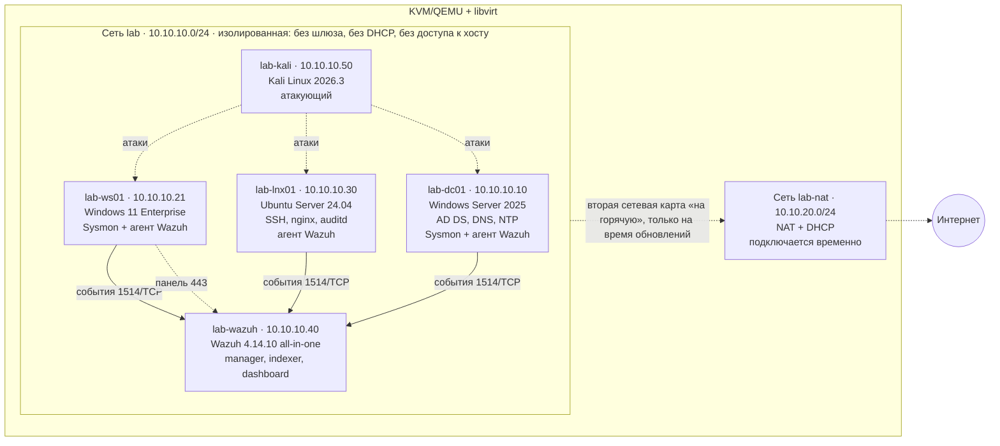

# Домашний SOC-стенд на KVM

Учебный стенд для подготовки к работе SOC-аналитиком: небольшой домен Active Directory, Linux-сервер, атакующая машина и SIEM **Wazuh**, собранные на одном компьютере в изолированной виртуальной сети. Стенд нужен, чтобы воспроизводить атаки и разбирать, как они выглядят в журналах и в SIEM.

> Пароли, ключи и другие секреты в этот репозиторий не входят — они хранятся отдельно. Все учётные записи домена — вымышленные.

**Состояние:** собран 14.11.2026, проверен по плану проверки 15.11.2026.

## Схема

## Машины

| ВМ | ОС | Роль | IP |
|---|---|---|---|
| lab-dc01 | Windows Server 2025 | Контроллер домена `lab.internal`, DNS, источник времени | 10.10.10.10 |
| lab-ws01 | Windows 11 Enterprise | Рабочая станция в домене | 10.10.10.21 |
| lab-lnx01 | Ubuntu Server 24.04 | Linux-сервер-мишень: SSH, nginx | 10.10.10.30 |
| lab-wazuh | Ubuntu Server 24.04 | SIEM Wazuh 4.14.10 (all-in-one) | 10.10.10.40 |
| lab-kali | Kali Linux 2026.3 | Атакующая машина | 10.10.10.50 |

Ресурсы, прошивка, MAC-адреса и сети — в [docs/infrastructure.md](docs/infrastructure.md).

## Главное из проверки

- Неверный пароль доменного пользователя виден с двух сторон: 4625 на рабочей станции и 4771 `0x18` на контроллере домена — события связываются по пользователю, времени и IP.
- SYN-скан `nmap -sS` хостовые агенты **не видят** — для этого нужен сетевой сенсор (Suricata/Zeek).
- Попытку подключить подставной агент Wazuh менеджер отклоняет, но в SIEM она **не видна**.
- Для 4771, 4768 и 4776 в стандартном наборе правил Wazuh нет отдельных правил — нужны свои.

Полная таблица — в [docs/detection-tests.md](docs/detection-tests.md).

## Документация

| Файл | Что внутри |
|---|---|
| [docs/infrastructure.md](docs/infrastructure.md) | Сети `lab` и `lab-nat`, машины, интернет через сетевую карту «на горячую» |
| [docs/active-directory.md](docs/active-directory.md) | Домен `lab.internal`: структура OU, учётные записи, DNS, время |
| [docs/windows-audit.md](docs/windows-audit.md) | GPO `LAB-Audit`: 4688 с командной строкой, журналы PowerShell, расширенная политика аудита |
| [docs/log-collection.md](docs/log-collection.md) | Агенты Wazuh, источники журналов, auditd, порты SIEM |
| [docs/lab-security.md](docs/lab-security.md) | Как защищён сам стенд |
| [docs/detection-tests.md](docs/detection-tests.md) | Что видно в SIEM и чего не видно (проверено) |
| [configs/](configs/) | Конфигурации: сети libvirt, netplan, auditd, фрагменты конфигов Wazuh, политика хранения алертов |

